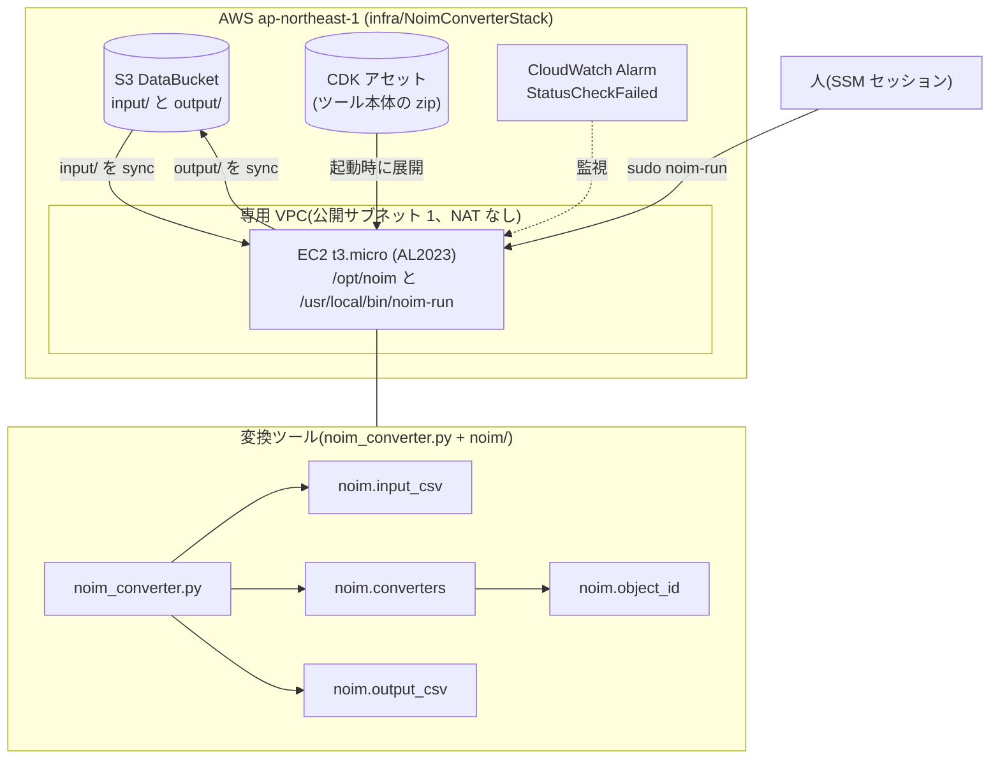
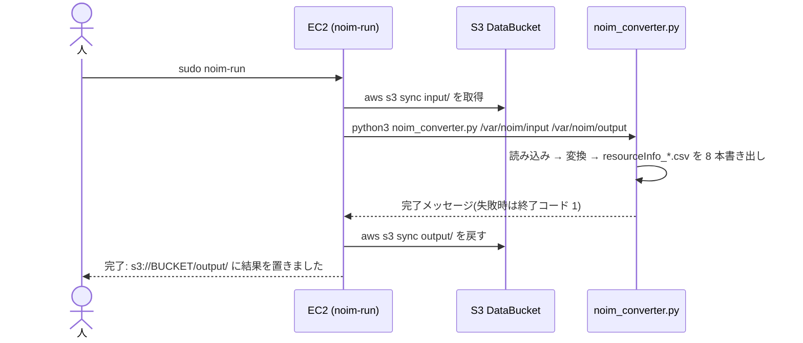
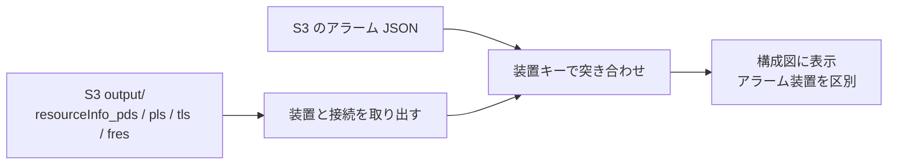

# Architecture

## Architecture Analysis

### System Overview

標準ライブラリだけの Python 製バッチ変換ツール(CLI)と、それを EC2 1 台で動かす CDK スタック 1 つ。DB、キュー、Web サーバー、API は無い。入出力はすべてファイル(ローカルのディレクトリ、または S3)。

### Architectural Style

バッチ処理(ファイル入力 → メモリ上で変換 → ファイル出力)のモノリス。サーバーレス要素は無い。根拠: `noim_converter.py` の `run()` が `load_inputs` → `convert_all` → `write_outputs` を順に呼ぶだけ。`infra/noim_stack.py` に Lambda、API Gateway、データベースは無い。

### Component Relationships

テキストでの説明: 人が EC2 に SSM で接続して `sudo noim-run` を実行する。EC2 は S3 の `input/` を取得して変換ツールを動かし、結果を S3 の `output/` に戻す。変換ツール内の呼び出し関係は `dependencies.md` にある。ツール本体は CDK アセット(S3 上の zip)として起動時に EC2 へ展開される。

### Data Flow

1. `input_csv.select_input_files`: 入力 DIR から種類ごとに最新のタイムスタンプのファイルを選ぶ。
2. `input_csv.read_rows`: CSV を `Row`(列名 → 値、`_list` 列は文字列のリスト)にする。
3. `converters.convert_all`: 次の順で変換する。順序は設計書どおりで、`objectId` の採番順に影響する。PStruct → PD → PPort → PLink → LD 層 TPE と TL → LAG 層 FRE と TPE → LD 層 TPE(仮想 PPort 相当) → NFD → 仮想 PPort
4. `output_csv.write_outputs`: 8 ファイルを一時ファイルに書いてから置き換える(`resourceInfo_*.csv`)。
5. `--expected` を指定すると、出力をバイト単位で期待結果と比較する。

出力の構造と参照関係は `api-documentation.md` を参照。

### Key Design Decisions

- `objectId` は種類ごとに 1 から採番し直す(`object_id.py`)。再現性は高いが、実行をまたいだ同一性は無い。
- `data` には入力の全列を `nttManagementInfo` として写す(`converters.management_info`)。認証情報の列も含む(`code-quality-assessment.md` を参照)。
- 参照は `objectId` の文字列で持つ。一部の関係は `objectId` ではなく入力の ID(`ra_vxm_id`)の値で持つ。両方の対応は `api-documentation.md` の「Reference Map」。
- EC2 はインバウンドを開けず、SSM で接続する。アウトバウンドは 443 のみ(S3 などへ)。
- PoC 設定: S3 は削除時に中身ごと消える。コード変更のデプロイで EC2 が作り直される。

### Improvement Opportunities

- 可視化向けの読み取り経路が無い。S3 バケットは非公開(`BLOCK_ALL`)で、読めるのは EC2 のロールだけ。
- アラームファイル用の置き場(プレフィックスや権限)が未定義。
- 出力が実行ごとに変わる `objectId` を使うため、アラームの突き合わせには `objectId` 以外のキーが必要(`api-documentation.md`「Alarm matching keys」)。

## Interaction Diagrams

### 変換の流れ(既存)

テキストでの説明: 人が `noim-run` を実行 → S3 `input/` を取得 → 変換 → S3 `output/` へ戻す。入力ディレクトリ内に 3 種以外のファイルがあるとエラーになる。

### 可視化とアラーム表示の流れ(新規・設計前の想定)

テキストでの説明: 出力 CSV から装置と接続を取り出し、アラーム JSON と装置キーで突き合わせて構成図に出す。この図は依頼の説明であり、既存のコードには無い。
