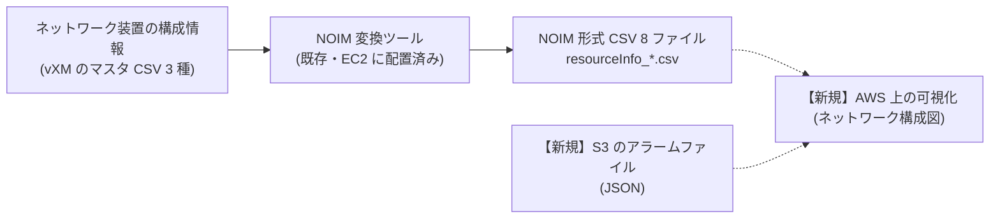

# Business Overview

## Business Context Diagram

テキストでの説明: 構成情報の CSV 3 種を変換ツールが NOIM 形式の CSV 8 ファイルにする(既存)。今回の新規作業は、その出力と S3 のアラームファイルを読み、構成図の上でアラームが出ている装置を見えるようにすること(点線)。

## Business Description

- **Business Description**: ネットワーク装置(ノード)、ポート(エンティティ)、回線(サービス)の 3 種の CSV を、NOIM 形式のリソース(JSON)に書き換える。出力は `resourceInfo_<種類>.csv` の 8 ファイルで、各行は `objectId` と `data`(JSON)の 2 列。
- **Business Transactions**:
  1. **変換(既存)**: 入力 DIR の CSV 3 種を読み、8 ファイルを出力 DIR に書く。EC2 上では `noim-run` が S3 の `input/` を取得し、結果を S3 の `output/` に戻す。
  2. **可視化(新規・未実装)**: 変換結果から「装置」と「装置間の接続」を取り出し、構成図として表示する。
  3. **アラームの見える化(新規・未実装)**: S3 にあるアラームの JSON を読み、アラームが出ている装置を構成図上で区別できるようにする。アラームファイルの形式はこのリポジトリに無い(後続で決める)。
- **Business Dictionary**:
  | 用語 | このコードでの意味 |
  |---|---|
  | NOIM | 出力形式の名前。リソースの種類は PStruct、PD、PPort、PLink、TPE、TL、FRE、NFD(略称の正式名はコードに記載なし。設計書 xlsx は今回開いていない) |
  | ノード | 入力 `t_mst_vxm_node_info_*.csv` の 1 行。装置。出力では PD になる |
  | エンティティ | 入力 `t_mst_vxm_entity_info_*.csv` の 1 行。ポートなど。出力では PPort になる |
  | サービス | 入力 `t_mst_vxm_service_*.csv` の 1 行。回線。`service_profile_name` が `物理(BR)`、`LSP詳細(BR)`、`VPN回線(BR)` の 3 種 |
  | CE | `node_type` の値の 1 つ。変換上は特別扱い(PStruct は固定の `全国`、`nttLadder` が 1) |
  | BR網 | `parent_node_group_name` の値。サンプルの 26 ノードすべてが `BR網` |
  | 仮想 PPort(vPort) | 入力に無く、変換が LAG 層の XC ごとに作る PPort(`commonName` が `vPort`) |

## Component Level Business Descriptions

各コンポーネントの役割は `component-inventory.md`、リソース同士の関係は `api-documentation.md` に書いた。ここでは繰り返さない。

- **変換ツール(`noim_converter.py` と `noim/`)**: 3 CSV から 8 CSV を作る。DB は使わない。同じ入力からは同じ出力になる(`objectId` は毎回 1 から採番)。
- **AWS 環境(`infra/`)**: 変換ツールを動かす EC2 1 台と、受け渡し用の S3 バケット 1 つ。可視化向けのものはまだ無い。

## 今回の依頼に対する前提(事実のみ)

- 可視化の入力になる出力ファイルは `resourceInfo_pds.csv`(装置)、`resourceInfo_pls.csv` と `resourceInfo_tls.csv`(物理的な接続)、`resourceInfo_fres.csv`(LSP の論理的な接続)。参照関係は `api-documentation.md` の「Reference Map」を参照。
- サンプル入力は装置 26、エンティティ 463、サービス 51 件。座標(緯度・経度)は全装置 `"0"` なので、地図配置には使えない。
