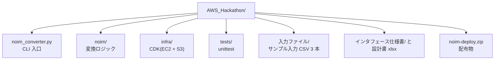

# Code Structure

## Build System

- **Type**: 本体はビルドなし(`python3 noim_converter.py ...` で直接実行)。`infra/` は AWS CDK(Python)。
- **Configuration**: `infra/cdk.json`(`app` は `python3 app.py`)、`infra/requirements.txt`。本体の依存管理ファイルは無い。

## Key Modules

テキストでの説明: ルート直下に CLI、変換パッケージ `noim/`、CDK `infra/`、テスト `tests/`、サンプル入力、仕様書(xlsx)、配布 zip がある。

### Existing Files Inventory

| パス | 種別 | 行数 | 目的 |
|---|---|---|---|
| `noim_converter.py` | Controller/Handler(CLI) | 103 | 引数解析、`run()`、期待結果との比較、終了コード |
| `noim/__init__.py` | Configuration | 1 | パッケージ宣言(docstring のみ) |
| `noim/converters.py` | Service/UseCase | 559 | 3 入力 → 8 種のリソース(辞書)への変換 |
| `noim/input_csv.py` | Repository/DAO(入力) | 213 | 入力ファイル選択、CSV 読み込み、PostgreSQL 配列表記の解析、列名定義 |
| `noim/output_csv.py` | Repository/DAO(出力) | 63 | `resourceInfo_*.csv` の書き出し |
| `noim/object_id.py` | Utility/Helper | 33 | `objectId` の採番と、固定の spec ID |
| `noim/errors.py` | Utility/Helper | 5 | `ToolError`(利用者に表示するエラー) |
| `infra/app.py` | Configuration | 24 | CDK アプリの入口(リージョン ap-northeast-1、タグ) |
| `infra/noim_stack.py` | Configuration | 186 | EC2 環境のスタック定義 |
| `infra/cdk.json`、`infra/requirements.txt`、`infra/.gitignore` | Configuration | - | CDK の設定と依存 |
| `infra/README.md` | Static/Asset(文書) | - | 構築・動作確認・後片付けの手順 |
| `tests/test_converters.py`、`test_input.py`、`test_output.py` | Test | 346、181、256 | 変換・入力・出力のテスト(`def test_` は合計 42) |
| `入力ファイル/*.csv` | Static/Asset | - | サンプル入力(ノード 26、エンティティ 463、サービス 51 行) |
| `インタフェース仕様書/*.xlsx`、`NOIM変換ツール_詳細設計書_ハッカソン.xlsx` | Static/Asset(文書) | - | 仕様書と設計書(今回は開いていない) |
| `noim-deploy.zip` | Static/Asset | - | 配布物(開いていない) |

## Design Patterns

### パイプライン(段階的な変換)
- **Location**: `noim/converters.py` の `convert_all`
- **Purpose**: 前段の結果(`unique_dict`、`pds`、`pports`、`tls`、`lag`)を後段の入力にして 9 段で変換する。
- **Implementation**: 1 つの `ObjectIdManager` を全段に渡して採番順を固定する。段の途中でほかのリソースを書き換える(例: `convert_pport` が PD の `_physicalConnector` に追記、`convert_ld_tpe_vport` が TCP の `nttServerTpeRefList` を設定、`convert_vport` が PD と TPE に追記)。

### 「すぐ失敗する」エラー処理
- **Location**: `noim/errors.py`、各 `convert_*`
- **Purpose**: 不整合は `ToolError` で止め、`noim_converter.main` が `エラー: ...` を stderr に出して終了コード 1 にする。

### 一時ファイルから置き換える書き込み
- **Location**: `noim/output_csv.write_outputs`
- **Purpose**: `.<名前>.tmp` に書いてから `os.replace`。失敗時は書き出し済みのファイルを残す。

## Critical Dependencies

依存の一覧と向きは `dependencies.md` を参照(外部は標準ライブラリのみ。`infra/` は `aws-cdk-lib` と `constructs`)。

## 命名規則

- 変換関数は `convert_<リソース>`、内部の補助は `_` 始まり。
- 出力 JSON のキーは設計書のとおり(`_` 始まりは参照や入れ子の項目)。`nttManagementInfo` のキーは「接頭辞(`node`/`entity`/`service`)+ 入力の列名の UpperCamelCase」(例: `node_primary_ipv4_address` → `nodePrimaryIpv4Address`)。例外はノードの `node_profile_name` で、`nodeProfileName` になる。
