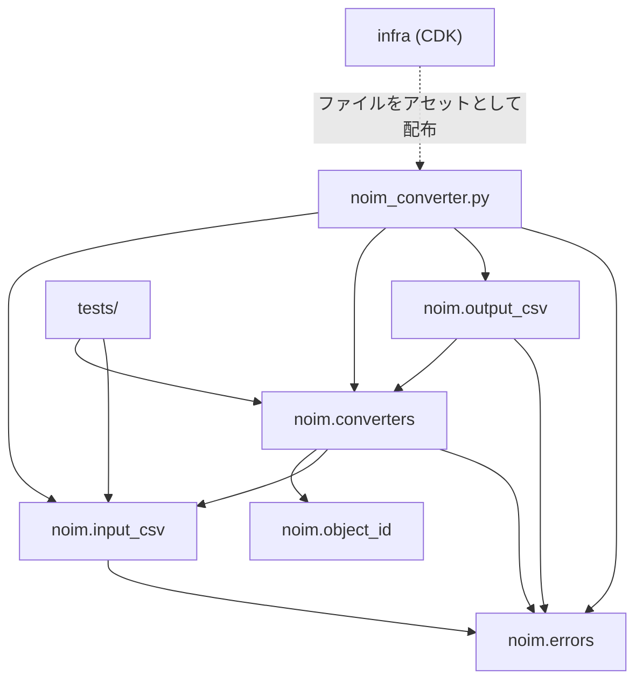

# Dependencies

## Internal Dependencies

テキストでの説明: `noim_converter.py` が `input_csv`、`converters`、`output_csv`、`errors` を使う。`converters` は `object_id`、`errors`、`input_csv`(列名の定義だけ)を使う。`output_csv` は `converters` から `RESOURCE_KINDS` を取り込む。循環参照はない。`tests/` から本体への依存は、`test_converters.py` の import(`noim.converters`、`noim.object_id`、`noim.errors`、`noim.input_csv`)だけ確認した(図にはその分のみ描いた)。他のテストファイルの import は読んでいない。`infra` は import ではなく、リポジトリのファイルを zip にして配るだけ。

### 隣接リスト

| モジュール | 依存先 |
|---|---|
| `noim_converter.py` | `noim.converters`、`noim.errors`、`noim.input_csv`、`noim.output_csv` |
| `noim.converters` | `noim.object_id`、`noim.errors`、`noim.input_csv` |
| `noim.output_csv` | `noim.converters`、`noim.errors` |
| `noim.input_csv` | `noim.errors` |
| `noim.object_id`、`noim.errors` | なし |

## External Dependencies

| 依存 | バージョン | 用途 | 使う場所 |
|---|---|---|---|
| Python 標準ライブラリ | Python 3 | CSV、JSON、ファイル、CLI | `noim_converter.py`、`noim/` |
| `aws-cdk-lib` | `>=2.140.0,<3.0.0` | CDK の構成要素 | `infra/` |
| `constructs` | `>=10.0.0,<11.0.0` | CDK の基底 | `infra/` |
| AWS CLI(EC2 に標準) | 未固定 | `aws s3 sync` | `noim-run`(EC2 上) |
| Node.js / `aws-cdk@2`(`npx`) | 未固定 | CDK のコマンド | デプロイ時(CloudShell) |

- 外部ライブラリの導入は `infra/` だけ。本体の依存解決は不要。
- 外部 API、データベース、メッセージキューへの依存はなし。
